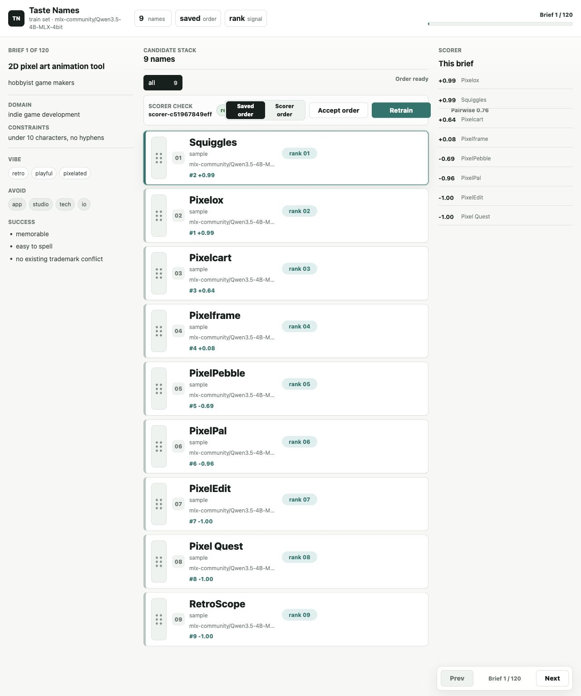
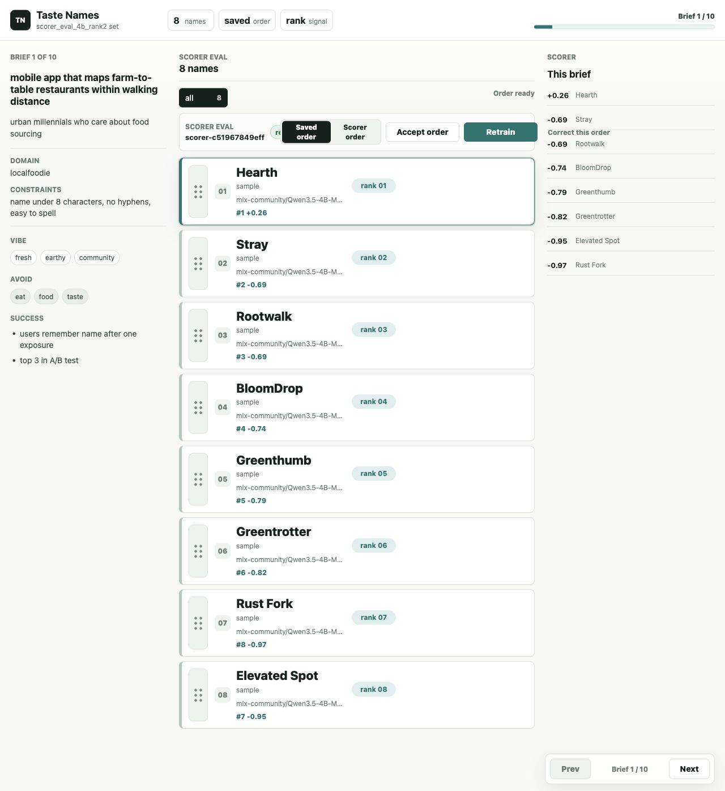
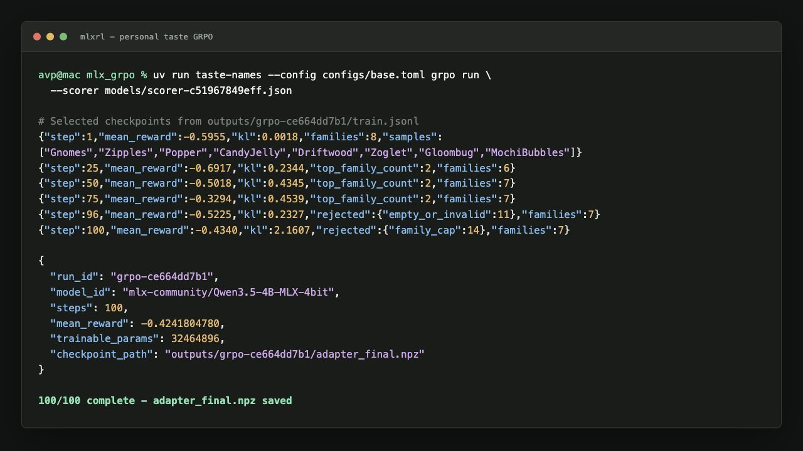
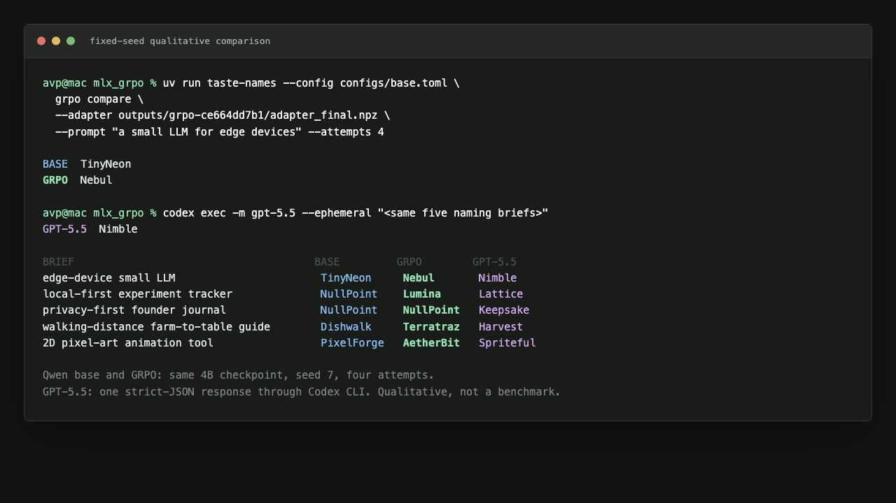

# Teaching a 4B Model My Taste in Names with GRPO on Apple Silicon

I wanted to test a deliberately subjective version of reinforcement learning:
could I teach a small local language model to propose project names that feel
more like names *I* would choose?

The result is a QLoRA adapter for
`mlx-community/Qwen3.5-4B-MLX-4bit`, trained for 100 GRPO steps on an Apple
Silicon Mac with [MLXRL](https://github.com/inductiveML/mlxrl). The final run
used a learned preference scorer, handwritten anti-reward-hacking guardrails,
120 synthetic naming briefs, and no remote inference during training.

The important result is not that one 4B model now has perfect naming taste. It
does not. The important result is how little reinforcement-learning machinery
I had to build. Once the reward function was trustworthy, MLXRL reduced the RL
part to four understandable operations:

1. load a local policy with LoRA;
2. generate a group of completions;
3. turn completions and rewards into a GRPO batch;
4. take an optimizer step.

Everything needed to reproduce that final training run is in this directory.

## The short version

The experiment produced:

- 120 training briefs;
- 924 Qwen3.5-4B training candidates;
- rank orderings converted into 3,703 pairwise preferences;
- a lightweight scorer with 75.7% held-out pairwise accuracy;
- 100 GRPO steps with groups of 8 candidates;
- 32,464,896 trainable LoRA parameters;
- a 124 MB final adapter;
- zero accepted empty, `None`, or `null` completions in the successful run.

On one fixed-seed prompt, the untouched base model and the final adapter did
this:

```text
Prompt: a small LLM for edge devices
Base:   TinyNeon
GRPO:   Nebul
```

That is not a benchmark. It is, however, exactly the kind of shift I wanted:
away from literal startup compounds and toward compact, slightly strange,
name-like words.

## Why naming is an interesting RL problem

Naming is a useful test because the task is easy to understand and hard to
specify.

I can explain some of my preferences:

- I dislike generic suffixes such as `Labs`, `Hub`, `AI`, and `Forge`;
- I usually prefer short names;
- I like concrete texture, motion, and slightly unusual sounds;
- I dislike names that merely restate the product category.

But those rules are incomplete. A name can satisfy every rule and still feel
wrong. Another can break a rule and still be excellent. That gap between
explicit rules and actual judgment is exactly where preference learning is
useful.

It is also where reward hacking appears. If the scorer learns that I often rank
`Vellum`, `Velvet`, and `Lumina` highly, the policy can discover that repeating
nearby lexical families is easier than understanding the brief. The experiment
therefore became two projects:

1. learn a useful approximation of my taste;
2. prevent the policy from exploiting that approximation.

## The complete pipeline

```text
OpenRouter + DeepSeek V4 Flash
        |
        v
120 synthetic naming briefs
        |
        v
local Qwen3.5-4B candidate generation
        |
        v
rank-only preference UI
        |
        v
linear taste scorer + validation rounds
        |
        v
learned reward + handwritten guardrails
        |
        v
MLXRL GRPO + QLoRA on Apple Silicon
        |
        v
base vs adapter vs GPT-5.5 comparison
```

OpenRouter was used only to create diverse fictional briefs. Candidate
generation, labeling, scorer training, reward calculation, GRPO, evaluation,
and inference were local.

The packaged example is smaller than the research workspace. It intentionally
contains only the pieces required to rerun GRPO:

```text
examples/personal_taste_grpo/
|-- README.md
|-- config.toml
|-- train.py
|-- compare.py
|-- taste_reward.py
|-- test_reward.py
|-- data/
|   |-- briefs.json
|   `-- scorer.json
`-- assets/
```

The labeling UI, SQLite history, raw rankings, API client, and the 124 MB final
adapter are not included.

## Step 1: generate diverse naming briefs

Training on one generic prompt would make it impossible to tell whether the
model learned taste or merely memorized a narrow answer pattern. I started by
generating fictional briefs across developer tools, consumer apps, food,
privacy, games, finance, and creative software.

The brief generator used OpenRouter with
`deepseek/deepseek-v4-flash`. Each row had strict structured fields:

```json
{
  "domain": "indie game development",
  "audience": "hobbyist game makers",
  "product": "2D pixel art animation tool",
  "constraints": ["under 10 characters", "no hyphens"],
  "vibes": ["retro", "playful", "pixelated"],
  "banned_patterns": ["app", "studio", "tech", "io"],
  "success_criteria": ["memorable", "easy to spell"]
}
```

The research command looked like this:

```bash
OPENROUTER_API_KEY=... uv run taste-names \
  --config configs/base.toml \
  generate-briefs \
  --count 120 \
  --seed 57 \
  --split train \
  --batch-size 10 \
  --concurrency 6
```

Parallel batches made generation quick, but they also exposed an important
data-engineering lesson: model-generated JSON must be validated before it
becomes training data. One batch returned placeholder values such as
`"string"`. Those rows were deleted and regenerated. The final parser rejected
missing fields, placeholder values, malformed arrays, and non-concrete text.

For the packaged example, the 120 validated briefs are already exported in
[`data/briefs.json`](data/briefs.json). No API key is required to train.

## Step 2: generate candidates with the untouched local model

The final dataset used the same model family that would later receive the GRPO
adapter:

```bash
uv run taste-names --config configs/base.toml \
  generate-candidates \
  --split train \
  --final-model \
  --per-brief 8 \
  --seed 7
```

That produced 924 usable Qwen3.5-4B candidates across the 120 training briefs.
The number is not exactly `120 x 8` because the workspace went through
regeneration and validation passes. Every candidate kept its source model,
brief, prompt, raw completion, and cleaned display name.

The base model was already surprisingly capable. This matters later: the
comparison is not between a random model and a trained model. "Base" means the
pretrained, instruction-tuned Qwen checkpoint with no preference adapter.

## Step 3: collect rank orderings, not labels

The first UI had labels such as keeper, reject, and cringe. I removed them.
They were slower to use and less informative than simply arranging the names
from best to worst.

The final interaction was:

1. read one brief;
2. drag the best candidate to the top;
3. keep reordering until the list matches my preference;
4. move to the next brief.

The order saved automatically after each change. There was no separate "save
order" step and no redundant pairwise button. A full ordering already tells us
that rank 1 beats rank 2, rank 1 beats rank 3, rank 2 beats rank 3, and so on.

The research UI can be launched with:

```bash
uv run taste-names --config configs/base.toml ui \
  --scorer models/scorer-c51967849eff.json
```



The screenshot shows the final-model filter, the brief on the left, draggable
candidates in the center, and the scorer's current prediction on the right.
The visible order is my saved ranking; the small score labels show where the
scorer would place each name.

Why ranking worked better than absolute labels:

- it matches the real question: "which of these would I actually choose?";
- it avoids calibrating what a 3/5 means across different briefs;
- one ordering creates many pairwise training examples;
- correcting a near miss is as simple as moving one row.

An ordering of eight candidates can imply up to 28 pairwise relationships.
Across training and scorer-validation rounds, the final scorer saw 3,703 such
preference examples from 140 distinct briefs.

## Step 4: train a tiny personal taste scorer

The reward model did not need to be another LLM. I used a sparse linear scorer
with:

- TF-IDF features over candidate-name tokens;
- character length and word count;
- digit and hyphen indicators;
- vowel ratio;
- generic-token overlap;
- banned-pattern overlap;
- direct overlap with the brief.

For candidate features `x`, the score is:

```text
score(x) = tanh(b + w.x)
```

Training combined pairwise logistic learning with the structural features. For
a preferred name `winner` and a lower-ranked name `loser`, the model learns on
the feature difference:

```text
delta = features(winner) - features(loser)
loss  = -log(sigmoid(w.delta))
```

The final scorer was tiny, inspectable, and fast enough to call repeatedly
inside rollout collection. Its saved JSON is only about 48 KB.

```bash
uv run taste-names --config configs/base.toml train-scorer --seed 7
```

The final scorer metrics were:

| Metric | Value |
|---|---:|
| Distinct preference briefs | 140 |
| Pairwise training examples | 3,703 |
| Held-out pairwise examples | 741 |
| Held-out pairwise accuracy | 75.7% |
| Ready for reward use | yes |

Seventy-six percent is not an oracle. It was good enough to become useful, but
only after manual validation.

## Step 5: validate the scorer on fresh briefs

I did not validate the scorer by staring at weight vectors. I generated fresh
briefs, let the scorer rank eight new candidates, corrected the ranking, then
retrained. Each round was deliberately small: ten briefs was enough to expose
obvious mismatches without turning validation into another large labeling job.

```bash
OPENROUTER_API_KEY=... uv run taste-names \
  --config configs/base.toml \
  scorer-eval create \
  --count 10 \
  --split scorer_eval_4b_rank2 \
  --per-brief 8 \
  --final-model \
  --scorer models/scorer-c51967849eff.json
```



The scorer-eval UI starts from the scorer's predicted order. I only move the
names I disagree with. Unchanged lists still count as accepted rankings. The
loop is intentionally plain:

```text
score fresh candidates -> inspect ten lists -> correct -> retrain -> repeat
```

This step mattered more than increasing scorer complexity. A simple model with
fast human correction was easier to trust than a larger opaque reward model.

## Step 6: turn taste into a reward without inviting collapse

The learned scorer supplies most of the reward, but not all of it:

```text
reward = 0.85 * learned_taste + 0.15 * auxiliary_reward
```

The auxiliary component includes penalties for:

- invalid or prose-like outputs;
- `None`, `null`, and other exact non-names;
- names shorter than three useful letters;
- unreadable consonant runs;
- banned patterns and generic startup tokens;
- literal copies from the domain, audience, or product;
- exact duplicates within a rollout group;
- near-duplicates from the same lexical family.

The crucial distinction is between a *penalty* and a *gate*. Some outputs
should never reach the optimizer, no matter what the learned scorer says.

The collector therefore rejects a completion before training when it is
invalid, too literal, low-information, unreadable, or would push one name
family over the group cap.

The family heuristic is intentionally simple:

```python
def name_family(name: str) -> str:
    compact = letters_only(name).lower()
    compact = strip_common_suffix(compact)
    return compact[:3]
```

That makes `Vellum`, `Velvet`, `Veloce`, and `Velva` members of the same
`vel` family. The successful configuration accepted at most two names from one
family in a group of eight.

The relevant settings are in [`config.toml`](config.toml):

```toml
[reward]
taste_weight = 0.85
aux_weight = 0.15
guardrail_scorer_cap = -0.75
family_duplicate_guardrail_threshold = 0.25
literal_copy_guardrail_threshold = 0.50

[run]
group_size = 8
rollout_attempts_per_step = 4
brief_attempts_per_step = 16
max_family_count = 2
```

The scorer cap is another safety valve. If a hard guardrail fires, the learned
taste score is capped at `-0.75`; a high lexical preference cannot rescue a
broken candidate.

## Step 7: the actual MLXRL integration

This is the part I expected to be difficult. It was the shortest part of the
project.

The policy setup is standard QLoRA:

```python
from mlxrl.policy import LoRAConfig, load_policy_with_lora

model, tokenizer, report = load_policy_with_lora(
    model_id="mlx-community/Qwen3.5-4B-MLX-4bit",
    config=LoRAConfig(
        rank=16,
        scale=2.0,
        dropout=0.0,
        grad_checkpoint=True,
    ),
)
```

For each brief, MLXRL generates a group of candidates:

```python
from mlxrl.rollout.naive import SamplingConfig, generate_group_rollouts

completions = generate_group_rollouts(
    model=model,
    tokenizer=tokenizer,
    prompts=[rendered_prompt],
    group_size=8,
    config=SamplingConfig(
        max_tokens=16,
        temperature=1.1,
        top_p=0.98,
        top_k=100,
    ),
    seed=seed,
    use_chat_template=False,
)
```

My code cleans the names, applies the hard gates, and computes eight scalar
rewards. MLXRL then owns the GRPO mechanics:

```python
from mlxrl.algo import GRPOAlgorithm
from mlxrl.train import batch_from_rollouts, optimizer_step

algorithm = GRPOAlgorithm()

batch = batch_from_rollouts(
    model=model,
    completions=completions,
    rewards=rewards,
    group_size=8,
    pad_token_id=pad_token_id,
    algorithm=algorithm,
    use_checkpoint=True,
    compute_reference=True,
)

metrics = optimizer_step(
    model=model,
    optimizer=optimizer,
    batch=batch,
    beta=0.10,
    pad_token_id=pad_token_id,
    algorithm=algorithm,
    use_checkpoint=True,
    micro_batch_size=0,
)
```

That call handles old-policy log probabilities, the adapter-disabled reference
policy, GRPO advantages, KL regularization, loss calculation, backward, and the
optimizer update.

The whole project-specific training loop lives in [`train.py`](train.py). The
reusable reward and guardrail logic lives in
[`taste_reward.py`](taste_reward.py). Neither file needs a trainer framework,
a distributed runtime, or a remote inference server.

## Step 8: two failed runs and what they taught me

The first experiments did collapse. This is important to include because a
reward curve alone made some bad runs look healthy.

### Failure 1: lexical family reward hacking

One 4B run increasingly produced variants such as:

```text
Vellum, Velvet, Veloce, Velva, Vellum, Velvet
```

The mean reward was improving. The names were individually valid. But the
policy had found a shortcut into the scorer's preferred lexical neighborhood.

The original family check used four-character prefixes and allowed three names
from one family. That failed to connect enough `Vell*` variants and was too
permissive for a group of eight.

The fix was:

- shorten the family key to three characters;
- cap each family at two accepted names;
- lower the duplicate guardrail threshold;
- monitor rolling family concentration, not just per-step reward.

### Failure 2: exact invalid outputs and overcorrection

Another run surfaced exact `None` outputs. They received bad reward, but they
still entered the training batch. A bad reward is not enough when a completion
should be categorically impossible.

I added `none` and `null` to the exact rejection set. Then I made the collector
too strict: hard briefs could burn many rollout attempts and appear hung. The
final collector balances both concerns by trying at most four rollout batches
per brief and moving to another brief after bounded failure.

The lesson is simple:

> GRPO did not fail because the optimizer was mysterious. It failed because the
> reward admitted loopholes.

## Step 9: run a one-step canary

Before a full run, test the exact model, scorer, reward, data, adapter shape,
and optimizer path with one step:

```bash
UV_CACHE_DIR=.uv-cache uv run python \
  examples/personal_taste_grpo/train.py \
  --steps 1 \
  --output-dir outputs/personal_taste_canary
```

The packaged canary was run against the real 4B model. It completed one GRPO
optimizer step, saved an adapter, loaded all 496 LoRA leaves in the comparison
script, and produced a group with seven distinct families.

The local reward tests are even cheaper:

```bash
UV_CACHE_DIR=.uv-cache uv run pytest \
  examples/personal_taste_grpo/test_reward.py
```

They verify the frozen assets, reject `None` and `null`, group `Vellum` and
`Velvet` into the same family, and exercise the scorer plus family guardrail.

## Step 10: run 100 GRPO steps

The final configuration was deliberately conservative:

| Setting | Value |
|---|---:|
| Model | `mlx-community/Qwen3.5-4B-MLX-4bit` |
| Steps | 100 |
| Group size | 8 |
| Maximum completion | 16 tokens |
| LoRA rank | 16 |
| LoRA scale | 2.0 |
| Learning rate | `1e-6` |
| KL beta | 0.10 |
| Temperature | 1.1 |
| Top-p | 0.98 |
| Top-k | 100 |
| Gradient checkpointing | yes |
| Checkpoint interval | 25 steps |

From the MLXRL repository root:

```bash
UV_CACHE_DIR=.uv-cache uv sync --all-groups
UV_CACHE_DIR=.uv-cache uv run python examples/personal_taste_grpo/train.py
```

Each step prints and appends one JSON row with reward, KL, samples, family
counts, and rejected-output counts. The run writes:

```text
outputs/personal_taste_grpo/<run-id>/
|-- adapter_step25.npz
|-- adapter_step50.npz
|-- adapter_step75.npz
|-- adapter_step100.npz
|-- adapter_final.npz
|-- train.jsonl
`-- summary.json
```



The successful run took roughly 25 minutes on the Apple Silicon machine used
for this experiment.

## What I monitored

Mean reward is necessary and insufficient. I monitored:

- `mean_reward`: is the sampled group becoming more preferred?
- `kl`: how far is the policy moving from the reference policy?
- `top_family_count`: is one lexical family dominating a group?
- `unique_family_count`: are outputs still diverse?
- `reject_counts`: is the policy probing the guardrails more often?
- `samples`: do the names still look like names?

The final aggregate diagnostics were:

| Diagnostic | Result |
|---|---:|
| Completed steps | 100 / 100 |
| Accepted training completions | 800 |
| Mean reward | -0.4242 |
| First-ten mean reward | -0.5693 |
| Last-ten mean reward | -0.4717 |
| Minimum unique families in a group | 5 |
| Maximum names from one family | 2 |
| Accepted empty/`None`/`null` outputs | 0 |
| Rejected empty or invalid outputs | 138 |
| Rejected literal copies | 17 |
| Rejected family-cap overflow | 40 |
| Rejected hard-guardrail outputs | 7 |

KL had isolated spikes, including `2.1607` on the final step. That deserves
attention, but it was not accompanied by output collapse: step 100 still had
seven name families and the collector rejected 14 additional family-cap
violations before forming the batch. I would not claim convergence from this
run; I would claim a clean 100-step experiment without the previous collapse.

## Final comparison: base vs GRPO vs GPT-5.5

I used five prompts, seed 7, and four generation attempts for both local Qwen
conditions. The base condition loads the untouched Qwen3.5-4B checkpoint. The
GRPO condition loads the same checkpoint plus `adapter_final.npz`.

For a frontier reference, I asked GPT-5.5 through Codex CLI for one strict JSON
response covering the same five briefs:

```bash
codex exec -m gpt-5.5 --ephemeral \
  "Generate one single-word name for each of these five briefs..."
```



| Brief | Untouched Qwen3.5-4B | GRPO adapter | GPT-5.5 via Codex |
|---|---|---|---|
| Small LLM for edge devices | TinyNeon | **Nebul** | Nimble |
| Local-first experiment tracker | NullPoint | **Lumina** | Lattice |
| Privacy-first founder journal | NullPoint | **NullPoint** | Keepsake |
| Walking-distance farm-to-table guide | Dishwalk | **Terratraz** | Harvest |
| 2D pixel-art animation tool | PixelForge | **AetherBit** | Spriteful |

My read of these results:

- `Nebul` is the clearest personalized win. It is shorter, less literal, and
  closer to the slightly strange sound I tended to rank highly.
- `Lumina` replaces the base model's repeated `NullPoint`, but it also exposes a
  learned taste signature: `lum*` was one of the scorer's favored families.
- The journal example did not move at all. GPT-5.5's `Keepsake` is plainly the
  strongest semantic answer in that row.
- `Terratraz` is more distinctive than `Dishwalk`, although also more obscure.
- `AetherBit` escapes the generic `PixelForge` template, but still carries a
  technical suffix. GPT-5.5's `Spriteful` is playful and legible, if literal.

This is a useful outcome precisely because it is mixed. GRPO moved the local
model toward a recognizable personal style, but it did not make a 4B model
universally better than a frontier model. GPT-5.5 remained stronger at semantic
fit on several prompts. The local adapter's advantage is different: it is
small, private, inspectable, cheap to run repeatedly, and tuned to one person's
ranking behavior rather than a generic naming prompt.

## Run your own comparison

After training, compare the base policy and adapter with:

```bash
UV_CACHE_DIR=.uv-cache uv run python \
  examples/personal_taste_grpo/compare.py \
  --adapter outputs/personal_taste_grpo/<run-id>/adapter_final.npz \
  --prompt "a small LLM for edge devices" \
  --attempts 4
```

The comparison script loads the base checkpoint first, clears it, rebuilds the
same LoRA structure, verifies every saved adapter leaf and tensor shape, then
generates from the adapted policy with the same sampling settings.

## What MLXRL made easy

The project still required real work:

- generating and validating data;
- building a ranking interaction that was fast enough to use;
- validating the scorer on fresh examples;
- diagnosing reward hacking from actual samples;
- deciding which heuristics should be penalties and which should be hard gates.

But none of that work was GRPO infrastructure.

MLXRL supplied the pieces that are easy to get subtly wrong:

- local 4-bit policy loading and LoRA injection;
- batched grouped rollouts;
- old-policy log-probability recomputation;
- reference-policy evaluation on the same model object;
- GRPO advantage and loss calculation;
- KL regularization;
- gradient checkpointing and optimizer integration;
- saving a small trainable adapter instead of a full model.

That separation is the reason this experiment stayed understandable. My code
owns the domain: briefs, names, preferences, scorer, reward, and guardrails.
MLXRL owns the policy-optimization mechanics.

## Limitations

This experiment should not be read as a general model benchmark.

- The preference data comes from one person.
- The scorer is only 75.7% accurate on held-out pairwise choices.
- The final run uses one seed and 100 steps.
- The five-row comparison is qualitative and uses one GPT-5.5 response.
- The prompts are not a blind human evaluation set.
- The final-step KL spike suggests that longer runs should retain aggressive
  monitoring and checkpoint evaluation.
- A lexical scorer can still encode superficial preferences even when
  guardrails prevent obvious collapse.

A stronger follow-up would blind-rank base, GRPO, and GPT-5.5 outputs over a
larger held-out set, report confidence intervals, and evaluate intermediate
adapters at steps 25, 50, 75, and 100.

## Reproduce the example

From a clone of MLXRL:

```bash
git clone https://github.com/inductiveML/mlxrl.git
cd mlxrl
UV_CACHE_DIR=.uv-cache uv sync --all-groups
```

Run the cheap reward tests:

```bash
UV_CACHE_DIR=.uv-cache uv run pytest \
  examples/personal_taste_grpo/test_reward.py
```

Run one real 4B step:

```bash
UV_CACHE_DIR=.uv-cache uv run python \
  examples/personal_taste_grpo/train.py \
  --steps 1 \
  --output-dir outputs/personal_taste_canary
```

Run the full 100-step experiment:

```bash
UV_CACHE_DIR=.uv-cache uv run python \
  examples/personal_taste_grpo/train.py
```

Requirements:

- Apple Silicon;
- Python 3.11 through 3.14;
- enough unified memory for `Qwen3.5-4B-MLX-4bit`;
- no API key for the packaged training run.

The final adapter is intentionally not committed because it is approximately
124 MB. The frozen scorer and sanitized briefs are committed, so the GRPO run
itself is fully local and reproducible.

## Closing thought

The most useful thing GRPO did here was not teach a model an objective truth.
It compressed a pile of small, inconsistent human choices into a local policy
that behaves differently in a recognizable direction.

That is a much more interesting use of post-training than asking a model to
maximize another generic benchmark. And with MLXRL, the reinforcement-learning
part was small enough to read in one sitting.
